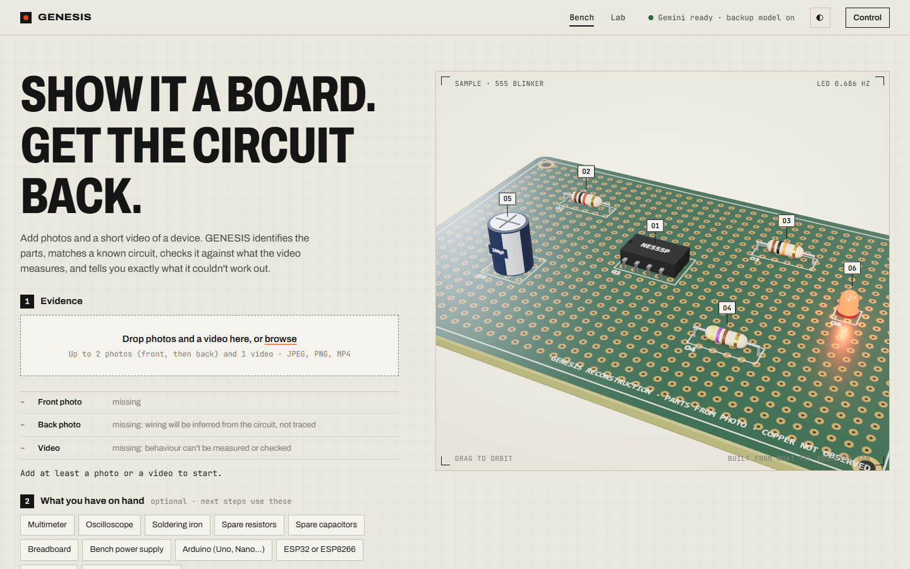
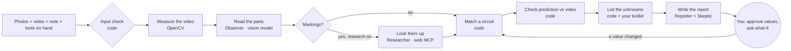
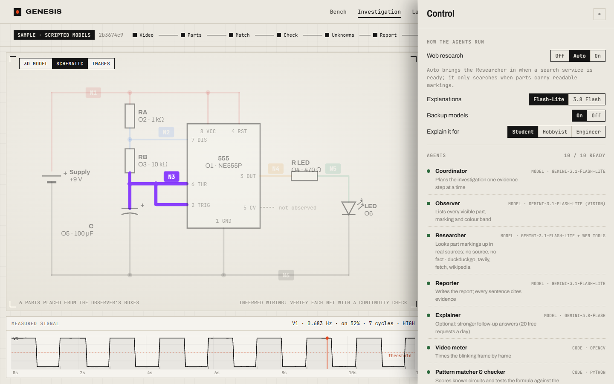
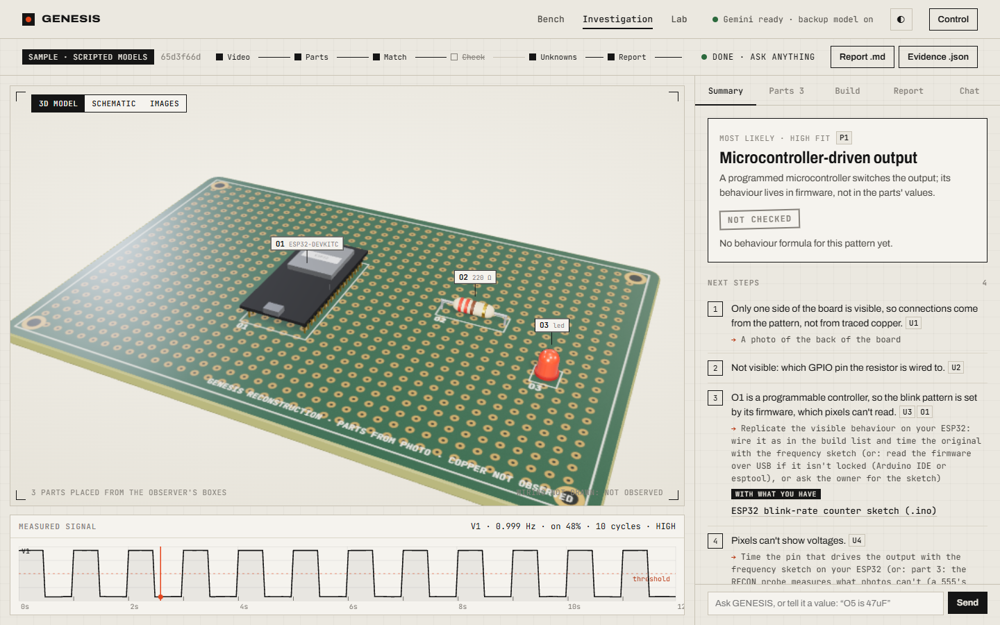
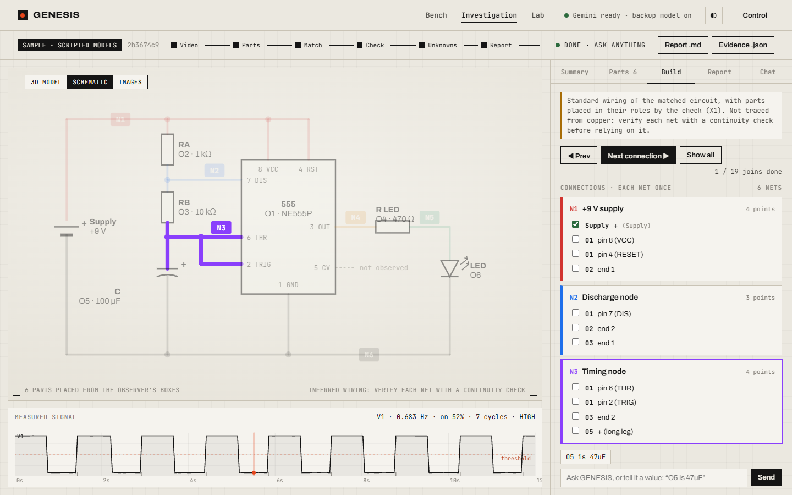
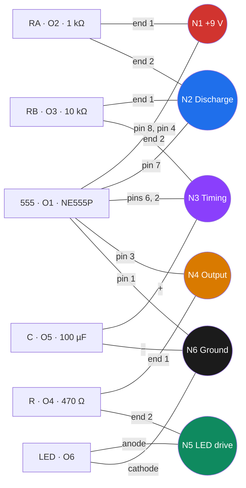
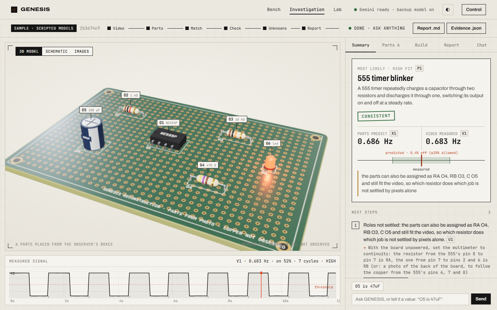
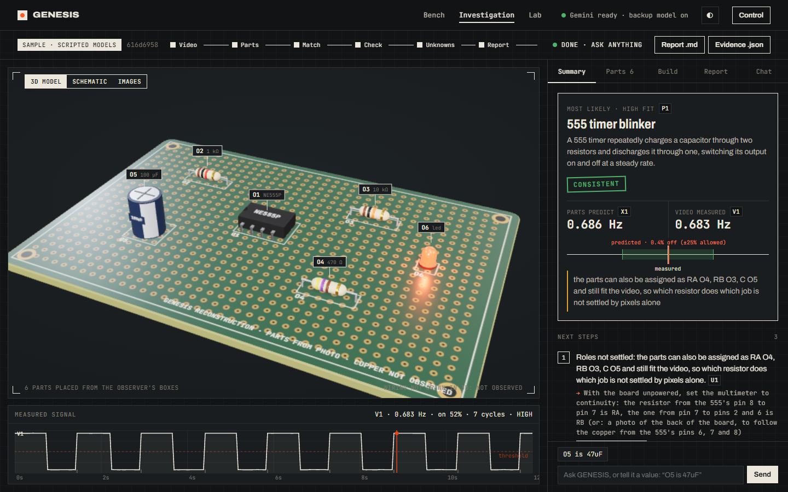
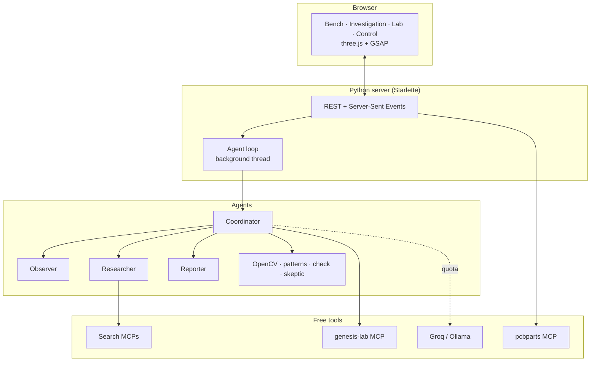

# GENESIS · See it

**Show it a board. Get the circuit back.**

Photos and a short video of an undocumented device go in.
Out comes the parts list, the circuit it matches, a check of that circuit against the device's real behaviour, a wiring diagram to rebuild it, and a report in which every sentence cites its evidence.

Repository: **https://github.com/B-Aladin/genesis-see**

> Present this file as slides: open it in VS Code with the *Marp for VS Code* extension (each `---` is a slide). On GitHub it reads as a normal document, and the Mermaid diagrams render.

---

## The problem

- A working gadget, kit or repair job with **no schematic**.
- A phone camera can see the parts and the blinking LED, but **not the copper, the voltages or the firmware**.
- AI vision alone will happily *guess* a value or a connection, and say it with confidence.

**GENESIS separates what was seen, what was measured, what was inferred, and what is still unknown, and says which is which.**

---

## What you get from one investigation

| You give | GENESIS returns |
|---|---|
| Front photo, optional back photo | Every visible part with its marking, colour bands and decoded value |
| 5 to 20 s video of it running | The blink rate and on-time, measured frame by frame |
| Optional note ("9 V battery") | The known circuit it matches, with a score per clue |
| Optional list of tools you have | A check: predicted behaviour vs measured, within part tolerances |
| | What can't be settled, and the next step you can actually do |
| | A cited report, a 3D model, a schematic, a build checklist, a parts list with live prices, Arduino / ESP sketches |

---

## See it running



The bench: one drop zone, a live checklist of what you've given (and what each gap costs), the tools you have on hand, and a 3D board you can orbit.

---

## How an investigation runs



**Models see and explain. Code measures and decides. A value only counts once you approve it.**

---

## The agent team

| Agent | Runs on | Job |
|---|---|---|
| Coordinator | Gemini 3.1 Flash-Lite | Plans one evidence step at a time; an evidence gate only offers the next allowed step |
| Observer | Gemini 3.1 Flash-Lite (vision) | Lists every visible part, marking and colour band, as structured data |
| Researcher | Flash-Lite + web MCP tools | Looks markings up in real sources; no source, no fact |
| Reporter | Flash-Lite (3.8 Flash optional) | Writes the report; every sentence cites evidence ids |
| Explainer | Gemini 3.8 Flash (optional) | Stronger follow-up answers; 20 free requests a day |
| Video meter | OpenCV (code) | Finds what blinks and times it, with hysteresis |
| Pattern matcher & checker | Python (code) | Scores known circuits; tests the formula against the video |
| Skeptic | Python (code) | Flags any sentence that cites nothing or invents a number |
| genesis-lab | MCP server (code) | Read-only calculators for what-if questions |
| Backup models | Groq or local Ollama | Take over when Gemini's free quota runs out |

---

## Free APIs and tools, fitted together when needed

| Integration | What it adds | Cost | When GENESIS uses it |
|---|---|---|---|
| DuckDuckGo MCP | Web search and page reading | free, no key | Research **Auto/On**, only if parts carry markings |
| Tavily MCP | Search built for agents | free 1,000 credits/month | Same, when `TAVILY_API_KEY` is set |
| fetch MCP | Reads datasheet pages as text | free | Same |
| Wikipedia MCP | Background on parts and circuits | free | Same |
| arXiv MCP | Papers | free | Off by default (rarely helps) |
| **pcbparts MCP** | JLCPCB / LCSC live stock and prices | free, no key | **Build → Find parts**, on demand |
| genesis-lab MCP | 555 / flasher / colour-code / E-series maths | local | What-if questions, the Lab page |
| Groq | `openai/gpt-oss-120b` backup model | free key | Only when Gemini returns a quota error |
| Ollama | `gemma4:e2b` local backup | free, local | Same, if Ollama is running |

Servers for later GENESIS parts (SPICE simulation, KiCad export, the RECON probe) are listed in Control but not used yet. Each server is handed to one agent role only, which keeps every model call small.

---

## Control: you decide what runs



- **Web research:** Off · Auto · On
- **Explanations:** Flash-Lite or 3.8 Flash
- **Backup models:** On · Off
- **Explain it for:** Student · Hobbyist · Engineer
- **Every free API:** live status (ready / missing key / off), switch each one off or on
- **Display:** Paper or **Night bench** theme · 3D labels · auto-rotate · run layout (split, wide stage, wide panel)

Settings are kept in your browser and sent with each run.

---

## It knows what you didn't give it

Before anything runs, code checks the inputs. The agents are told what's missing, and the report has to say what that prevents.

| Missing or weak | What it costs | How GENESIS adapts |
|---|---|---|
| No video | Behaviour can't be measured or checked | Check step is skipped and marked **NOT CHECKED**; first next step is a video, or the Arduino/ESP blink counter if you have one |
| No front photo | Parts are read from small video frames | Observer is warned; values it can't read are worked out (INFERRED) and need your approval |
| No back photo | Wiring comes from the pattern, not traced copper | Schematic is labelled *inferred*; continuity steps are suggested |
| Blurry, dark or small photo | Markings and bands may be misread | Observer is told to return a marking only if every character is crisp |
| Video under 5 s, or over 30 s | Too few cycles, or trimmed | Flagged up front; confidence drops accordingly |
| No tools listed | — | Next steps are photos and videos |

Try it: the sample board comes as **full set**, **photo only**, **video only** and **ESP32 board**.

---

## Your toolkit changes the next steps

| You have | A typical next step becomes |
|---|---|
| Multimeter | "Board unpowered, continuity mode: the resistor from pin 8 to pin 7 is RA, the one from pin 7 to pins 2 and 6 is RB" |
| Oscilloscope | "Probe pins 2 and 6: expect a sawtooth between 1/3 and 2/3 of the supply; probe pin 3 for the frequency" |
| Arduino | Download a **blink-rate counter** or **voltage logger** sketch, sized for your circuit |
| ESP32 / ESP8266 | Same sketches for 3.3 V boards (ESP32 uses `analogReadMilliVolts` on GPIO34) |
| Logic probe | "Touch pin 3: it should blink in step with the LED" |
| Magnifier or macro lens | Close-ups of the parts it couldn't read |
| Spare capacitors + breadboard | Swap test: the blink rate should change in proportion |

---

## Arduino and ESP, both ways

**As the device under investigation**
- New part type `dev_board` (Arduino Uno / Nano / Pro Mini, NodeMCU, Wemos D1 mini, ESP32 DevKit).
- Markings such as ATmega328, ESP32-WROOM, CH340 identify an **Arduino-compatible controller** or an **ESP32 / ESP8266 Wi-Fi controller**.
- The firmware sets the blink pattern, and GENESIS says so: pixels can't read code.



**As your measuring instrument**
- Every sketch includes a voltage divider computed from the supply, rounded to the safe side:

| Supply | Arduino (5 V pin) | ESP32 (3.3 V pin) |
|---|---|---|
| 9 V | 15 kΩ + 10 kΩ → 3.96 V max | 27 kΩ + 10 kΩ → 2.68 V max |
| 12 V | 22 kΩ + 10 kΩ → 4.12 V max | 39 kΩ + 10 kΩ → 2.69 V max |

The supply comes from your note or the board notes; for a controller's own pin it's the logic level. A shared ground is always required.

---

## Diagrams for replication



- **Schematic** of the matched circuit (555 timer, two-transistor flasher, microcontroller output) with your part ids and values.
- **Every connection is colour-coded by net** (N1, N2…). *Next connection ▶* lights one net at a time on the schematic, everything else dims.
- **Build checklist:** tick each join as you make it; progress is saved.
- **Parts to replicate it:** one click searches JLCPCB / LCSC for in-stock matches (surface-mount substitutes are labelled).
- Downloads: **schematic .svg**, **build sheet .md** with a Mermaid diagram.

---

## A build sheet, generated

Each net is joined once. This is the 555 sample exactly as GENESIS exports it:

| Net | Join these |
|---|---|
| **N1 +9 V supply** | Supply + · O1 pin 8 (VCC) · O1 pin 4 (RESET) · O2 end 1 |
| **N2 Discharge node** | O1 pin 7 (DIS) · O2 end 2 · O3 end 1 |
| **N3 Timing node** | O1 pin 6 (THR) · O1 pin 2 (TRIG) · O3 end 2 · O5 + (long leg) |
| **N4 Output** | O1 pin 3 (OUT) · O4 end 1 |
| **N5 LED drive** | O4 end 2 · O6 anode (long leg) |
| **N6 Ground** | Supply − · O1 pin 1 (GND) · O5 − (stripe side) · O6 cathode (flat side) |



---

## The answer, with its evidence



- **Summary:** the most likely circuit, the verdict (CONSISTENT / CONTRADICTED / INFERRED / NOT CHECKED) on a tolerance gauge, next steps, the evidence you gave, and the runner-up circuits.
- **Parts:** each part cropped from your photo, with its status (OBSERVED, INFERRED, CONTRADICTED) and how its value was read.
- **Report:** every sentence carries clickable evidence chips; the skeptic strikes through anything ungrounded.
- **Chat:** ask follow-ups, or state a value ("O5 is 47uF"). GENESIS asks you to approve it, then re-runs the match and the check.

---

## Accuracy safeguards

1. **Code measures, models describe.** Frequency, duty cycle, value decoding, pattern scores and the check are deterministic Python.
2. **Evidence gate.** The coordinator is only offered the next step its evidence allows.
3. **Input check first.** Missing or poor evidence is named before the run and carried into the prompts and the report.
4. **Image-quality cautions.** The observer is told which photos are blurry, dark or small.
5. **Human approval.** An inferred or typed value becomes a recorded value only when you approve it.
6. **Skeptic.** Uncited sentences, cites to evidence that doesn't exist, and numbers not in the evidence are flagged.
7. **Honest labels.** Wiring is marked *inferred, verify with continuity*; parts searches are *suggestions*; sketches state the supply they assumed.
8. **Tested.** 69 tests, zero Gemini requests: scripted stand-ins drive the real coordinator, tools, middleware, approvals and memory.

---

## Night bench



The same bench in a dark theme for the workshop: switch with the ◐ button or in Control.

---

## All options at a glance

**Web bench (`python -m genesis_see.web`)**

| Option | Where | Values |
|---|---|---|
| Evidence | Bench → drop zone | up to 2 photos (front, back), 1 video |
| On hand | Bench → chips + free text | multimeter, oscilloscope, soldering iron, spare resistors, spare capacitors, breadboard, bench supply, Arduino, ESP32/ESP8266, logic probe, magnifier |
| Note | Bench | free text, used as a hint only |
| Samples | Bench | full set · photo only · video only · ESP32 board |
| Research / Explanations / Backup / Reader | Control | Off-Auto-On · Flash-Lite or 3.8 Flash · On-Off · Student-Hobbyist-Engineer |
| Integrations | Control | each free MCP server on or off |
| Theme / labels / rotate / layout | Control | Paper or Night · On-Off · On-Off · split, wide stage, wide panel |
| Stage view | Investigation | 3D model · Schematic · Images |
| Shortcuts | URL | `/#demo` runs the sample, `/#lab` opens the Lab |
| Server | command line | `--host` (default 127.0.0.1), `--port` (default 8000) |

**Command line (`python -m genesis_see.run`)**

| Flag | Meaning |
|---|---|
| `--photo` (×2) | front, then back photo |
| `--video` | 5 to 20 s video |
| `--note` | what you already know |
| `--have "multimeter, arduino"` | tools on hand (tailors the next steps) |
| `--flash` | let 3.8 Flash write the report and answer follow-ups |
| `--reader` | who the explanations are for |
| `--no-research`, `--enable NAME`, `--disable NAME` | control the web tools |
| `--work-dir` | where key frames and `evidence.json` go |

---

## Exports

| File | Contents |
|---|---|
| **Report .md** | Evidence given, the matched circuit, the check, parts table, unknowns with next steps, the cited report with skeptic flags, the build sheet and a Mermaid wiring diagram |
| **Evidence .json** | The full evidence state, replayable as a test fixture at zero Gemini cost |
| **Schematic .svg** | The colour-coded wiring diagram |
| **Sketch .ino** | Arduino / ESP32 / ESP8266 blink-rate counter or voltage logger, with its divider |

---

## Lab

Two calculators backed by the same code the agent calls:

- **Resistor colour code:** pick the bands; it reads either end and says which direction it used, or that the code is ambiguous.
- **555 blink rate:** type RA, RB and C (`4k7`, `104`, `100uF`) to get frequency, period and duty, with a live LED and waveform.

---

## Architecture



| File | Role |
|---|---|
| `genesis_see/agent.py` | Coordinator, subagents, tools, middleware |
| `genesis_see/core.py` | Value decoding, video analysis, patterns, check, skeptic |
| `genesis_see/inputs.py` | Input check, image quality, toolkit-aware next steps |
| `genesis_see/diagrams.py` | Nets, build steps, Mermaid |
| `genesis_see/sketches.py` | Arduino / ESP measurement sketches and dividers |
| `genesis_see/sourcing.py` | JLCPCB search through pcbparts |
| `genesis_see/web.py` | HTTP + SSE server, Markdown export |
| `genesis_see/demo.py` | Sample boards and scripted stand-ins |
| `web/src/*` | UI: bench, 3D board, schematic, scope, control |

---

## Run it

```powershell
py -3.12 -m venv .venv
.venv\Scripts\Activate.ps1
pip install -e ".[test,free-models,mcp-tools]"
copy .env.example .env      # add GOOGLE_API_KEY (and optionally GROQ_API_KEY, TAVILY_API_KEY)
cd web; npm install; npm run build; cd ..
python -m genesis_see.web   # open http://localhost:8000
```

No key yet? The four sample boards run the real pipeline with scripted models: zero Gemini requests.

Tests: `pytest -q` (69 tests; the video tests need `ffmpeg` on PATH).

---

## Limits, stated plainly

- Pixels can't show copper on the far side, voltages or firmware: those stay **unknown** until you measure them.
- Built-in circuit knowledge covers 555 timers, two-transistor flashers, microcontroller outputs, light sensors, relay and motor drivers, PIR sensors, regulators and rectifiers. Anything else gets a parts list but no wiring.
- Wiring diagrams are the matched circuit's standard wiring, not traced. Verify with continuity before relying on them.
- Parts search returns catalogue suggestions; check the package (through-hole vs surface-mount) before ordering.
- Free tiers: 3.8 Flash allows 20 requests a day; one investigation uses about 9 Flash-Lite requests.

---

## Next

- Datasheet RAG over the PDFs the Researcher finds
- SPICE simulation of the reconstructed circuit (spicelib MCP, already catalogued)
- KiCad schematic export (kicad_schematic MCP, already catalogued)
- The RECON probe: measured voltages instead of inferred ones
- Memory across investigations (SQL)

**Repository:** https://github.com/B-Aladin/genesis-see
