# GENESIS · See · Simulate · Build — everything it uses, in the order it uses it

**Show it any electronic device. Get the circuit back.**
Photos and a short video of an undocumented device go in: a blinker kit, an Arduino or ESP project, a USB charger, a power supply, an amplifier. Out come what the device is, its parts, the circuit they form, a check against the device's real behaviour, an electrical simulation with rating warnings and fixes, what is still unknown, a wiring diagram to rebuild it, and a report in which every sentence cites its evidence.

Repository: **https://github.com/B-Aladin/genesis**

This document walks through one investigation from start to finish. At each step it names what is used (model, library, API, algorithm) and how. Reference tables at the end list every component.

```mermaid
flowchart LR
  S0[0 Start] --> S1[1 Open the bench] --> S2[2 Give evidence] --> S3[3 Choose tools and agents]
  S3 --> S4[4 Input check] --> S5[5 Agents built] --> S6[6 Measure video]
  S6 --> S7[7 Read parts] --> S8[8 Look up markings] --> S9[9 Match circuit]
  S9 --> S10[10 Check vs video] --> S11[11 Unknowns + next steps] --> S12[12 Cited report]
  S12 --> S13[13 You approve / ask] --> SIM[13b Simulate + what-if] --> S14[14 Diagrams + build] --> S15[15 Parts + sketches]
  S15 --> S16[16 Save, share, learn]
  S13 -. value changed .-> S9
  SIM -. Fix this .-> SIM
```



**The rule behind every step:** models *see* and *explain*; code *measures*, *simulates* and *decides*; a value only counts once a person approves it.

---

## 0 · Starting the app

| What | How it is used |
|---|---|
| `start.ps1` / `start.sh` | One command. The first time it creates the Python 3.12 virtual environment, installs the package, copies `.env.example` to `.env`, and builds the interface with npm. Then it starts the server and opens the browser. `-Lan` / `--lan` enables phone capture. |
| `python -m genesis_see.web` | The server itself (`--port`, `--host`, `--lan`). |
| **Starlette** 1.7 | HTTP routes, file uploads, and the live event stream (Server-Sent Events). |
| **uvicorn** 0.54 | Runs the server. GENESIS starts it on a **Selector event loop**, because on Windows the default Proactor loop stops accepting connections for good after one aborted connection. |
| **A second event loop for the agents** | Investigations run in a background thread on their own loop (Proactor on Windows, the only kind that can launch subprocesses). Video measurement and model calls therefore never freeze the web server. Results cross back thread-safely. |
| **python-dotenv** | Loads `GOOGLE_API_KEY`, `GROQ_API_KEY` and `TAVILY_API_KEY` from `.env`. |
| **Warm-up** | At start-up, in the background: probes for backup models, draws both sample boards with OpenCV, starts the **genesis-lab MCP server**, and builds the demo agents. The first click is then instant. |
| **Saved investigations** | `product.load_sessions` reads every `.genesis_work/web/*/session.json`, so the History list survives restarts. |

---

## 1 · Opening the bench (browser)

| What | How it is used |
|---|---|
| **Vite** 8 | Bundles the interface into `web/dist`, which the Python server serves. `npm run dev` gives hot reload during UI work. |
| **three.js** 0.186 | The 3D board: a perfboard with a canvas-drawn silkscreen, lit by a room environment map with soft shadows. Parts are built from geometry: DIP chips with their printed marking, resistors with their **actual decoded colour bands**, electrolytic cans, LEDs with a real point light, TO-92/TO-220 packages, and Arduino/ESP dev boards. Orbit controls, part picking, and labels projected from 3D into HTML. |
| **GSAP** 3.15 + **SplitText** | Motion: headline reveal, parts dropping onto the board, panel transitions, the approval card, schematic wires drawing in. The ticker runs on real time, so a slow GPU never slows the animations down. |
| Archivo + JetBrains Mono | Typefaces (Google Fonts). |
| `GET /api/info` | Is a Gemini key set? Is a backup model available? Is phone capture on? Today's usage. |
| `GET /api/control` | The Control panel's list of agents and free services with live status. |
| `localStorage` | Your preferences (theme, layout, research mode, switched-off services) and build-checklist ticks. Kept in this browser only. |

---

## 2 · Giving the evidence

| What | How it is used |
|---|---|
| **One drop zone** | Photos become *front*, then *back*. A video fills the video slot. Swap and remove buttons. |
| **Instant checks in the browser** (canvas) | Each photo is scaled to 480 px; its sharpness (variance of the Laplacian) and brightness are measured and its size checked. Videos are probed for length. Warnings appear before you upload anything. |
| **Readiness checklist** | Front, back and video, each marked given, missing or weak, with what a gap costs: "missing: behaviour can't be measured or checked". |
| **Capture tips** | Five rules: straight above, photograph the back, 10 to 20 s of video resting still, MP4 on iPhone, say what you know. |
| **Phone capture** (`--lan` + **qrcode**) | The server detects this computer's address on your network (a UDP socket that sends nothing) and the bench shows a QR code. Scan it, shoot on the phone, run; the run appears in History on the computer too. Off by default, because anyone on that network could use your key. |
| **Re-run with added evidence** | From a finished run, "Add the missing evidence" returns to the bench with the earlier photos and video kept. Add, say, the back photo, and the server copies the old files and adds the new one (`from=<id>`). |

---

## 3 · Choosing tools on hand and agent settings

| What | How it is used |
|---|---|
| **On-hand chips** | Multimeter, oscilloscope, soldering iron, spare resistors, spare capacitors, breadboard, bench supply, **Arduino**, **ESP32/ESP8266**, logic probe, magnifier, plus free text. They rewrite the next steps (step 11). |
| **Note** | Passed to the Observer as a *hint, not evidence*. A supply voltage in it ("9 V battery") sizes the Arduino/ESP voltage dividers. |
| **Control panel** | Web research **Off / Auto / On**. Explanations on **Flash-Lite or 3.8 Flash**. Backup models **On/Off**. Reader level **Student / Hobbyist / Engineer**. Every free service switchable. Theme **Paper / Night bench**, 3D labels, auto-rotate, run layout. Today's usage per model. |
| **Samples** | *Full set*, *photo only*, *video only*, *ESP32 board*. The real pipeline runs with scripted stand-ins for the models: zero Gemini requests. |

---

## 4 · Checking the inputs (code, before any model runs)

`POST /api/investigations` saves the uploads; then **`inputs.assess`** (OpenCV) checks them:

| Check | How |
|---|---|
| Photo size | longest side under 1,000 px → "fine markings may be unreadable" |
| Photo sharpness | variance of the Laplacian on a 1,000 px copy, below 60 → "looks blurry" |
| Exposure | mean grey below 55 or above 215 → dark / overexposed |
| Video | length (under 2 s, under 5 s, over 30 s) and frame rate (under 20 fps) |
| Missing pieces | no front photo, no back photo, no video, each with its cost |

The result is stored in the agent state. It drives three things:
- the coordinator's prompt ("Missing or weak input: … never fill a gap with a guess")
- the Observer's cautions ("Photo 1 looks blurry: give a marking only if every character is crisp")
- the task itself (with no video, it is told the behaviour can't be checked)

---

## 5 · Building the agent team

| What | How it is used |
|---|---|
| **LangChain** `create_agent` (1.3) | Builds the coordinator and its three subagents. |
| **LangGraph** (1.2) | Runs the agent graph: state, streaming updates, interrupts for approval, and an `InMemorySaver` so follow-ups continue the same thread. |
| **langchain-google-genai** → **Gemini 3.1 Flash-Lite** | Coordinator, Observer, Researcher and Reporter. |
| **Gemini 3.8 Flash** (optional) | Explanations and follow-up answers once the report exists (20 free requests a day). |
| **langchain-groq** → `openai/gpt-oss-120b` | Backup model when Gemini returns a quota error, if `GROQ_API_KEY` is set. |
| **langchain-ollama** → `gemma4:e2b` | Local backup, if Ollama is running. |
| **langchain-mcp-adapters** + **MCP** | Loads tools from MCP servers. The research servers (step 8) are started only if research is on and a server is ready. |
| **genesis-lab** (own MCP server, FastMCP, stdio) | Read-only calculators: colour bands, value parsing, 555 and flasher frequency, nearest E-series value. |
| **UsageCounter** (LangChain callback) | Counts every chat-model call, including subagents, by provider: per run (the chip in the run bar) and per day (`usage.json`). |

**Middleware wrapped around every model call:**

| Middleware | What it does |
|---|---|
| `EvidenceGate` | Only the next step the evidence allows is offered as a tool. |
| `stage_prompt` | The system prompt carries the investigation so far, the input gaps and your toolkit. |
| `ChooseModel` | Flash-Lite while investigating; 3.8 Flash for explanations if allowed. |
| `QuotaFallback` | On a rate-limit error, the same request is retried on Groq, then Ollama. |
| `SummarizationMiddleware` | Long follow-up chats are summarised after about 12,000 tokens. |
| `HumanInTheLoopMiddleware` | `confirm_value` pauses for your approve, edit or reject. |

---

## 6 · Step 1 — Measure the video (`watch_video`, code)

| What | How |
|---|---|
| **OpenCV** + **NumPy** | Frames are sampled at up to 30 fps over the first 30 s, shrunk to 160 px and converted to grey. |
| Changing-region detection | Per-pixel brightness spread over time finds what changes. Connected components give up to three regions. If more than 15 % of the picture changes, the camera moved. |
| Waveform analysis | The brightness trace of each region gets edges detected with hysteresis (10 % of the swing), then frequency, duty cycle, cycle count, jitter and a confidence. |
| Relations | Two regions that alternate (negatively correlated) mean "two lights take turns". |
| Key frames | The brightest and darkest frames are saved with the changing area boxed in magenta, for the Observer. |
| In the UI | The **scope** draws the measured trace with its threshold and rising edges. Its playhead and the **3D LED** share one clock, so the board blinks exactly as the video measured. |

---

## 7 · Step 2 — Read the parts (`observe_parts`, Observer subagent)

| What | How |
|---|---|
| **Gemini 3.1 Flash-Lite, vision** | Up to four images (photos and video key frames) sent as image blocks with the hint and the image-quality cautions. |
| **Pydantic structured output** | The answer must fit `Observation`: each part's type, exact marking, colour bands, printed value, image, box, confidence and one sentence of evidence; the changing area; board notes; what it can't see. |
| **What the device is** | The Observer also fills `device`: what kind of device it is, the text printed on it (brand, model, ratings like "5V 2A") and its connectors, but only when the enclosure, labels or ports show it. It becomes a citable board note and the chip next to the project name. |
| `core.normalize_observation` | Types are normalised and ids assigned O1, O2… Part types now cover whole devices: `dev_board` (Arduino, NodeMCU, Wemos, ESP32 DevKit), `transformer`, `fuse`, `optocoupler`, `speaker`, `microphone`, `antenna`, alongside resistors, capacitors, ICs, LEDs, transistors, MOSFETs, diodes, relays, crystals, inductors, connectors, batteries, switches, sensors, displays and regulators. |
| Value decoding (code) | Colour bands are read in both directions and scored, with ambiguity flagged. Printed values (`4k7`, `104`, `100uF 16V`) are parsed. Values are formatted. |
| In the UI | Parts drop onto the 3D board at the observer's boxes (moved aside if they collide). The Parts tab shows each part cropped from your photo. The Images view draws the boxes on the photos. |

---

## 8 · Step 2b — Look up the markings (`identify_parts`, Researcher subagent)

Runs only when research is **On**, or **Auto** with a search server ready, and only for parts with readable markings.

| Free service (MCP server) | How it is used |
|---|---|
| **DuckDuckGo** (`uvx duckduckgo-mcp-server`) | Web search and page reading, no key |
| **Tavily** (`npx tavily-mcp`) | Search built for agents (free 1,000 credits/month, key) |
| **fetch** (`uvx mcp-server-fetch`) | Reads datasheet pages as text |
| **Wikipedia** (`uvx wikipedia-mcp`) | Background on parts and circuits |
| arXiv | Available, off by default |

The Researcher returns `PartFacts` (identity, function, key facts, **source URLs**). A fact with no URL is dropped: *no source, no fact*. Each server is given to this one agent only, with only its useful tools, which keeps every call small.

---

## 9 · Step 3 — Match a circuit (`match_patterns`, code)

Known circuits are scored clue by clue against the parts and the video, from small circuits to whole devices:

| Kind | Circuits |
|---|---|
| Timing and blinking | **555 timer blinker**, two-transistor flasher, **microcontroller-driven output** |
| Power | **switch-mode power supply / mains adapter** (transformer, optocoupler, controller IC such as OB2263, TNY, LNK, VIPer), **Li-ion charger** (TP4056, MCP73831, IP5306, DW01), **DC-DC buck** (LM2596, MP1584, XL4015), **DC-DC boost** (MT3608, XL6009), linear regulator (78xx, AMS1117, LM317), rectifier and filter |
| Sound, sensing, motion | **audio amplifier** (LM386, PAM8403, TDA, TPA), **sensor module** (DHT11/22, HC-SR04, BME280, MPU6050, DS18B20…), light sensor with comparator, light-controlled transistor switch, PIR motion sensor, relay driver, motor driver |

Further identifications describe what is on the board: **Arduino-compatible controller** (ATmega328/32U4, CH340), **ESP32 / ESP8266 Wi-Fi controller** (ESP32, WROOM, NodeMCU, Wemos), **USB-to-serial interface** (CH340, CP2102, FT232) and **wireless module** (HC-05, nRF24, LoRa, BLE).

Each result carries its score, how many clues could be checked, the clues found with their evidence ids, the clues missing and the clues not checked. In the UI these become the answer card, the candidate bars and "Also on the board".

---

## 10 · Step 4 — Check against the device (`check_prediction`, code)

| Circuit | Formula | How |
|---|---|---|
| 555 astable | f = 1.44 / ((RA + 2·RB)·C) | Every assignment of the seen resistors and capacitors to RA, RB and C is tried. The best is compared with the measured frequency within part tolerances (25 % for electrolytics, 12 % otherwise) and with the duty cycle. |
| Two-transistor flasher | T = 0.693·(R1·C1 + R2·C2) | Same idea. |

The verdict is one of:
- **CONSISTENT:** predicted and measured agree.
- **CONTRADICTED:** they don't; it says which part would explain the gap, e.g. "O5 would explain the video if it were about 100 µF".
- **INFERRED:** a value nobody could read was worked out from the blink rate, and needs your approval.
- **NOT CHECKED:** no video, or no formula for this circuit.

Ambiguous role assignments are reported, not hidden. In the UI: a stamp, predicted vs measured readouts, and a tolerance gauge.

---

## 11 · Step 5 — What's unknown, and what you can do next (`list_unknowns`)

| What | How |
|---|---|
| `core.investigate` (code) | What the pixels can't settle: roles not settled, back not visible, values unreadable or ambiguous, contradictions, no video, a camera that moved, voltages. Each comes with what to capture next. |
| **`inputs.tailor`** (code) | Rewrites each next step for the tools you have, with priority oscilloscope › Arduino/ESP › multimeter › logic probe. It also adds input-quality gaps and, for a controller, the fact that its firmware can't be read from pixels. |
| **Arduino / ESP sketches** (`sketches.py`) | If you have one, a step can link to a generated `.ino`: a **blink-rate counter** (samples every millisecond, finds edges with the same 10 % hysteresis as the video meter, reports frequency, duty and swing every 5 s) or a **voltage logger** for the Serial Plotter (with 1/3 and 2/3 supply reference lines for a 555). |
| Divider sizing | R1 is rounded up to the next E12 value so the pin stays within 4.5 V (Arduino) or 2.9 V (ESP), with 10 % headroom. For example, 9 V on an Arduino gives 15 kΩ + 10 kΩ (3.96 V max); on an ESP32, 27 kΩ + 10 kΩ (2.68 V max). The supply comes from your note, the board notes, or a controller's logic level. |

Examples: with a multimeter, "board unpowered, continuity: the resistor from pin 8 to pin 7 is RA". With no video but an Arduino, "time the output electrically with the frequency sketch".

---

## 12 · Step 6 — Write the report (`write_report`, Reporter + Skeptic)

| What | How |
|---|---|
| Evidence brief (code) | Every fact as a line with an id (O, B, D, V, P, X, U). Nothing else exists for the Reporter. |
| **Reporter** (Gemini, structured output `Report`) | Five sections: what it is, how it works, how sure, what we don't know, what to capture next. Every sentence carries the ids it rests on; at most 230 words. |
| **Skeptic** (code) | Flags any sentence that cites nothing, cites an id that doesn't exist, or uses a number not in the evidence (within 3 %). |
| In the UI | The Report tab with clickable evidence chips; flagged sentences struck through with the skeptic's reason. The coordinator then replies in three sentences: what it is, whether the prediction matched, the most useful next capture. |

---

## 13 · You in the loop: approve, ask, what-if

| What | How |
|---|---|
| `confirm_value` + interrupt | "O5 is 47uF" in chat, or an INFERRED value, pauses the run. The approval card offers **Approve, Edit value, Reject**. On approval, code re-runs the match, the check and the unknowns, and marks the report out of date. |
| Follow-ups | Same thread (memory). Suggestion chips adapt: "O5 says 100uF" when a value was inferred, "What if O3 were 22k?", "Rewrite the report". |
| What-if | The coordinator calls the **genesis-lab** calculators and labels results SIMULATED. Read-only tools are retried up to three times (`ReadOnlyRetryInterceptor`); anything that could act on hardware never is. |

---

## 13b · Simulate, what-if and Fix this (`simulate.py`, code)

The matched circuit is simulated from its wiring and part values, with no model involved. It runs automatically with every evidence update and again whenever you change something.

| Circuit | What is computed |
|---|---|
| 555 astable | Capacitor voltage (exponential charge to 2/3 of the supply through RA+RB, discharge to 1/3 through RB) and the output square wave; blink rate and on-time; LED current; power in the LED resistor and in RA (which pin 7 shorts to ground every cycle); capacitor voltage rating; supply current and battery life; CMOS 555 output limits. |
| Two-transistor flasher | Both collector waveforms; each LED's current; base drive vs collector current (a gain of at least 100 assumed); the reverse base-emitter breakdown that occurs above about 6 V. |
| Microcontroller / Arduino / ESP output | Pin current against the chip's limit (ATmega328P 20 mA recommended / 40 mA max, ESP32 20 / 40 mA, ESP8266 12 mA); LEDs that need more than a 3.3 V pin can give; the measured blink from the video. |

| What | How |
|---|---|
| **Warnings with a fix** | Each warning names the part and the problem, e.g. "LED current 56 mA is above the 20 mA a typical LED is rated for". When a value would fix it, the fix is computed and rounded to a standard E12 value ("O4 → 470 Ω"). **Fix this** applies it as a what-if and re-simulates. |
| **What-if** | Edit any resistor or capacitor in Properties, or press a suggestion such as "What if 1 kΩ?", or type `what if O4 is 220` in the assistant. The simulation updates instantly. What-ifs are labelled SIMULATED · WHAT-IF and never change the recorded evidence. **Undo** steps back. **Record** sends the value through the normal approval, so it becomes evidence only once you approve it. |
| **Supply** | Taken from your note or the board notes ("9 V battery"), or the controller's logic level; otherwise assumed and labelled. You can set it in the Lab panel. |
| **Assumptions** | Every result lists what it assumed: LED forward voltage from its colour, 1/4 W resistors, the 555 output drop, battery capacity. |
| In the UI | The Simulation tab under the board draws the waveforms (`chart.js`) with readings beside them. Properties shows each part's current and power against its rating. The red warning card under the result holds the warning and **Fix this**. |

---

## 14 · Diagrams and the build list (replicating the circuit)

| What | How |
|---|---|
| `diagrams.wiring` (code) | The matched circuit's **nets** (everything that must be joined) with the observed parts placed in their roles, taken from the check when it ran. Covered: 555 astable (both LED wirings), two-transistor flasher, microcontroller / Arduino / ESP output. Polarity is spelled out (long leg, stripe side, flat side, pin numbers). |
| **Schematic** (SVG, `schematic.js`) | Drawn with your part ids and values; **every net in its own colour with an N-badge**. *Next connection ▶* lights one net and dims the rest. |
| **Build checklist** | Each join has a tick box; progress is saved. Hovering a net highlights it on the schematic. |
| Honesty | Labelled "standard wiring of the matched circuit … not traced from copper: verify with a continuity check". Parts not seen are listed as missing. |
| Exports | **Schematic .svg**; the **Markdown build sheet** with a parts table, a nets table and a **Mermaid** diagram (GitHub renders it). |

---

## 15 · Buying the parts and measuring with your own board

| What | How |
|---|---|
| **pcbparts MCP** (free, no key) → **JLCPCB / LCSC** | *Find parts* on the Components page: one live catalogue search per part, in parallel (`jlc_search`), showing the LCSC code, model, package, stock and price, with links. When no through-hole match is in stock, the surface-mount equivalent is shown and labelled. Only runs when you click. |
| Arduino / ESP sketches | The same `.ino` files as step 11, also on the Lab page for any open investigation. |

---

## 16 · Saving, sharing and learning

| What | How |
|---|---|
| **Saved runs** (`product.py`) | When each turn ends, the run is written to `session.json` (events plus the last evidence snapshot). After a restart it opens read-only and can be exported, shared, deleted or **re-run**. |
| **Projects** | Every saved run as a card with its name (renameable), device, verdict, rating and age; refreshes every 6 s, so runs started on a phone appear. Delete asks first and removes the uploads too. |
| **Share / PDF** | `/#report/<id>`: a clean report page (verdict, evidence, parts with crops, schematic, nets, unknowns, cited report) with *Print / Save as PDF* and *Copy link*. |
| `.md` / `.json` | The full Markdown report and the replayable evidence file. |
| **"Was this right?"** | Yes / Partly / No plus a note, kept with the run and appended to `feedback.jsonl` with the circuit, verdict, evidence count and toolkit. The cheapest accuracy signal there is. |
| **Usage meter** | Calls this run (run bar) and today per model (Control); 3.8 Flash shown against its 20 free requests a day. Sample runs are scripted and free. |

---

## 17 · Interface map

Layout: a navy sidebar, a cream workspace, maroon actions and tan chips, with icons from **Lucide** (open source, from GitHub). Paper and Night themes.

| Place | What's there |
|---|---|
| **Sidebar** | Workspace · Components · Build · Lab · Assistant · Projects, and Control. Collapses to an icon rail on tablets; becomes a bottom bar on phones. |
| **Top bar** | Project name (click to rename), the device chip, progress (what the agents are doing), usage, Undo (what-ifs), Share, Paper / Night, New, and **Run** (start an investigation) or **Simulate** (once one is open). |
| **Workspace, before a run** | The new-investigation page: drop zone, phone capture, readiness checklist, capture tips, tools you have, what you know, *Run investigation*, and four free samples. |
| **Workspace, during a run** | Centre: **3D View · Schematic · Photos** (Rotate, Capture), with the **Lab panel** under it: **Simulation · Measurements · Waveforms**. Right: the **result card** (what it is, verdict, Genesis's summary, Read report, Build it), the **warning card** (Fix this), **Components** (filter chips and tiles), **Properties** (editable value, current and power against ratings, Record), **Next steps**. On tablets and phones the right column slides over the board. |
| **Assistant** | A bar along the bottom with a context chip (the selected part) and suggestions; expands into **Chat · Report · Activity**. Questions about a selected part carry it as context. |
| **Components** | Every part with its photo crop, how its value was read, board notes, what couldn't be seen, and **Find parts** with live prices. |
| **Build** | The colour-coded schematic, *Next connection ›*, the tick-box checklist, notes, SVG and Markdown downloads. |
| **Lab** | Resistor colour-code decoder, 555 blink-rate calculator, and Arduino / ESP measurement sketches for the open investigation. |
| **Projects** | Saved investigations; New investigation. |
| **Control** | Agents, free services, usage today, display. |

---

## Reference A · Python packages

| Package | Version | Used for |
|---|---|---|
| langchain | 1.3.14 | `create_agent`, middleware, tools |
| langchain-core | 1.5.3 | messages, callbacks (usage meter), structured output |
| langgraph | 1.2.10 | agent graph, streaming, interrupts, memory |
| langchain-google-genai | 4.3.2 | Gemini 3.1 Flash-Lite and 3.8 Flash |
| langchain-mcp-adapters | 0.3.1 | MCP tools for the agents; pcbparts client |
| mcp | 1.29.0 | genesis-lab server (FastMCP) |
| opencv-python-headless | 5.0 | video measurement, key frames, photo quality, sample boards |
| numpy | 2.5 | waveform maths |
| pydantic | 2.13 | `Observation`, `Report`, `PartFacts` schemas |
| starlette | 1.7.0 | web server, SSE |
| uvicorn | 0.54.0 | runs the web server |
| python-multipart | 0.0.32 | uploads |
| python-dotenv | 1.2 | `.env` |
| langchain-groq · langchain-ollama | 1.1 · 1.1 | backup models (optional) |
| uv | 0.12 | `uvx`, which starts the Python MCP servers (optional) |
| pytest · pytest-asyncio | 9.1 | tests |

## Reference B · Front-end packages

| Package | Version | Used for |
|---|---|---|
| three | 0.186 | 3D board, parts, LED light, picking |
| gsap (+ SplitText) | 3.15 | all motion |
| qrcode | 1.5.4 | phone-capture QR code |
| lucide | 1.x | interface icons (open source, github.com/lucide-icons/lucide) |
| vite | 8.3 | build and dev server |

## Reference C · Models

| Model | Provider | Role | Free tier |
|---|---|---|---|
| gemini-3.1-flash-lite | Google | coordinator, observer (vision), researcher, reporter | its own free quota; one investigation ≈ 9 calls |
| gemini-3.8-flash | Google | explanations (optional) | 20 requests a day |
| openai/gpt-oss-120b | Groq | backup on quota errors | free key |
| gemma4:e2b | Ollama (local) | backup on quota errors | free, local |

## Reference D · MCP servers (free tools)

| Server | Role | Status in GENESIS |
|---|---|---|
| genesis-lab | coordinator | **used**: calculators, what-if |
| duckduckgo, tavily, fetch, wikipedia | researcher | **used** when research is on |
| arxiv | researcher | available, off by default |
| pcbparts | sourcer | **used** on demand: Find parts |
| spicelib, spicebridge | simulator | catalogued for Part 2 |
| kicad_schematic | schematic | catalogued for Part 2/3 |
| playwright | sourcer | off (can click and submit forms) |
| genesis_recon | hardware | Part 3 (the RECON probe) |
| mpremote | none | excluded (bypasses hardware safety rules) |
| context7, deepwiki, git, filesystem, memory, sequential_thinking, time | dev | for your coding agent, not GENESIS |

## Reference E · HTTP API

| Method | Path | Purpose |
|---|---|---|
| GET | `/api/info` | key present, backups, LAN address, today's usage |
| GET | `/api/control` | agents and free services with status |
| GET | `/api/materials` | the on-hand list |
| GET | `/api/usage` | usage today and the last 7 days |
| POST | `/api/investigations` | start a run: photos, video, note, materials, options, `sample`, `from` |
| GET | `/api/investigations` | History |
| DELETE | `/api/investigations/{id}` | delete a run and its uploads |
| GET | `/api/investigations/{id}/events` | live event stream (SSE), resumable |
| POST | `/api/investigations/{id}/decision` | approve, edit or reject a value |
| POST | `/api/investigations/{id}/ask` | follow-up question |
| POST | `/api/investigations/{id}/feedback` | Was this right? |
| GET | `/api/investigations/{id}/evidence` | evidence snapshot (.json) |
| GET | `/api/investigations/{id}/report.md` | Markdown report and build sheet |
| GET | `/api/investigations/{id}/sketch?kind=&board=` | Arduino / ESP sketch |
| POST | `/api/investigations/{id}/source` | JLCPCB parts search |
| POST | `/api/investigations/{id}/simulate` | simulation with what-if values and supply |
| POST | `/api/investigations/{id}/title` | rename a project |
| POST | `/api/lab/{bands,555,parse}` | Lab calculators |
| GET | `/files/{id}/…` | uploads and key frames |

## Reference F · Files

| File | What it does |
|---|---|
| `genesis_see/agent.py` | coordinator, subagents, tools, middleware, prompts |
| `genesis_see/core.py` | value decoding, video analysis, patterns, check, unknowns, brief, skeptic |
| `genesis_see/media.py` | photo loading, video reading, key frames |
| `genesis_see/inputs.py` | input check, image quality, toolkit-aware next steps |
| `genesis_see/diagrams.py` | nets, build steps, Mermaid |
| `genesis_see/sketches.py` | Arduino / ESP sketches and dividers |
| `genesis_see/sourcing.py` | JLCPCB search via pcbparts |
| `genesis_see/simulate.py` | electrical simulation, rating checks, fixes, what-if |
| `genesis_see/product.py` | saved runs, usage meter, feedback, LAN address |
| `genesis_see/web.py` | HTTP + SSE server, event loops, Markdown export |
| `genesis_see/demo.py` | sample boards (555, ESP32) and scripted stand-ins |
| `genesis_see/lab_server.py` | genesis-lab MCP server |
| `genesis_see/run.py` | command-line investigation (`--photo`, `--video`, `--note`, `--have`, `--flash`, `--reader`, `--no-research`, `--enable`, `--disable`) |
| `genesis_see/integrations/` | MCP catalog, loader, doctor, skills |
| `web/src/main.js` · `app.css` | the interface: workspace, panels, assistant, pages, Control, phone, report page; the design system |
| `web/src/bench3d.js` · `schematic.js` · `scope.js` · `chart.js` · `lab.js` | 3D board · schematic · measured scope · simulated waveforms · Lab |
| `start.ps1` · `start.sh` | one-command start |
| `tests/` | 77 tests |

---

## Tested

**77 tests, zero Gemini requests.** Scripted stand-ins drive the real coordinator, subagents, tools, middleware, approvals and memory. genesis-lab runs over real stdio; OpenCV reads real H.264 files (made with ffmpeg). The new parts are covered too: input checks, toolkit tailoring, voltage-divider safety for every board and supply, wiring nets, dev-board recognition, saved-run round trip, usage counting through subagents, feedback, the simulator (formula, what-if fixes, ESP pin current, no-model case) and whole-device recognition (chargers, converters, mains adapters, amplifiers, sensors).

## Limits, stated plainly

- Pixels can't show the far side's copper, voltages or firmware; those stay **unknown** until measured.
- Wiring diagrams are the matched circuit's standard wiring, not traced. Verify with continuity.
- Wiring diagrams cover the 555 timer, the two-transistor flasher and microcontroller outputs. The other matched circuits, and boards that match nothing, get the parts list, the match and the check, but no wiring.
- The simulator covers the 555 timer, the two-transistor flasher and microcontroller outputs, and states its assumptions (LED forward voltage from colour, 1/4 W resistors). It is a design check, not a SPICE model.
- Parts search returns catalogue suggestions; check the package before ordering.
- A saved run can't continue its conversation after a restart (its agent memory was in RAM); re-run it instead.
- Phone capture exposes the bench to your local network; use it only on networks you trust.

## Run it

```powershell
.\start.ps1            # Windows      (.\start.ps1 -Lan for phone capture)
./start.sh             # macOS/Linux  (./start.sh --lan)
```

Then open http://localhost:8000. No key yet? The four sample boards run the whole pipeline for free.

**Repository:** https://github.com/B-Aladin/genesis
